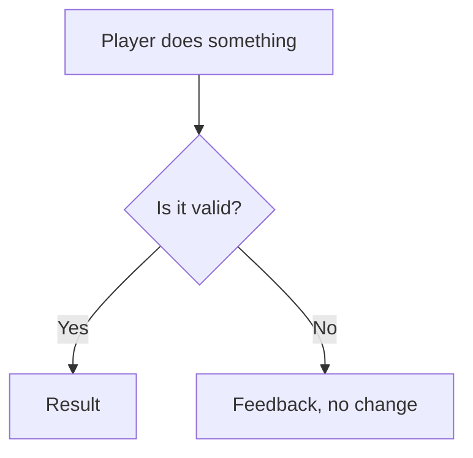

# Document structure

The file map, the per-feature template, and the conventions that make a GDD citable. Read this at the start of Phase 5.

---

## 1. File map

Numbered so the files sort in reading order. Names are suggestions — adapt them to the project's vocabulary, but keep the three-part shape: orientation, features, reference.

| File | Covers |
| --- | --- |
| `README.md` | Index, audience table, conventions, change control, sources, revision history |
| `00-game-overview.md` | Vision, design pillars, target player, the game at a glance, direction beyond this milestone |
| `01-<scope>-scope.md` | The staging model, feature list with IDs and priorities, in and out of scope, exit criteria, traceability |
| `02-core-gameplay-loop.md` | The loop, its rhythm, a sample first session, pacing targets |
| `03-…` … `12-…` | **One file per feature**, in dependency order |
| `13-game-data-tables.md` | Every tunable value in one place, grouped by feature |
| `14-playtest-and-acceptance.md` | Exit gate, criteria index, playtest plan, tuning levers, what is *not* being tested |
| `15-glossary-and-open-questions.md` | Glossary, decisions log, open questions, what comes after |

Feature files run from the most foundational to the most dependent, so the document can be read front to back.

---

## 2. Per-feature template

Every feature file, without exception. A feature with little content still gets every section — an empty edge-case table is a finding, not a formatting problem.

````markdown
# F-0n — <Feature name>

**Priority: Must** · <stage or phase> · Tracker items: *<item names, or "none yet — new work">*

---

## 1. Purpose and role in the game

Why this feature exists, in two or three short paragraphs. What breaks without it.
Tie it to a design pillar by name. This section is what a stakeholder reads.

---

## 2. The player's experience

Prose. What it feels like from the player's side — no rules, no numbers.
Someone should be able to picture the feature from this section alone.

---

## 3. <Content section, if the feature has content>

Layout, states, tool matrix, item categories — whatever this feature's substance is.
Tables and a diagram. Omit only if the feature genuinely has no content of its own.

---

## 4. Rules

| ID | Rule |
| --- | --- |
| **F-0n.R1** | One rule. Unambiguous. Testable. States the behaviour, not the reason. |
| **F-0n.R2** | Cross-references another rule where they interact (`F-05.R9`). |

---

## 5. <Flow diagram>



One or two sentences under it saying what to notice. A diagram with no reading is decoration.

---

## 6. Edge cases

| Situation | Behaviour |
| --- | --- |
| The unusual thing a player will do | Exactly what happens |

Edge cases are where a GDD earns its keep. Aim for five to eight per feature.
Include the ones that look like bugs but are intended.

---

## 7. Acceptance criteria

| ID | Criterion |
| --- | --- |
| **F-0n.AC1** | Something one person with a build can check in a few minutes. |

Each criterion must be checkable without reading the rest of the document.

---

## 8. Open questions

- `[OPEN Qn]` The question. **Proposed answer.** Why, and what it costs to defer.
````

---

## 3. Identifiers

The single most valuable convention in the document.

| Form | Means | Cited by |
| --- | --- | --- |
| `F-01` … `F-nn` | A feature | An SDD, an epic, a sprint plan |
| `F-05.R9` | One rule inside feature 5 | A backlog issue — "implements F-05.R9" |
| `F-05.AC2` | One acceptance criterion | A ticket's definition of done, a QA pass |
| `EC-1` … `EC-n` | A milestone exit criterion | The milestone review |
| `[OPEN Qn]` | An unresolved question | Whatever it blocks |

**Rules for IDs:**

- Never renumber. If a rule is removed, retire its ID and leave a gap.
- Never reuse a retired ID for something else.
- A rule that needs splitting becomes two new IDs at the end, not `R9a` and `R9b`.
- When citing an ID in prose, wrap it in backticks so it is greppable.

---

## 4. Priority vocabulary

Use exactly three words, defined in the README:

- **Must** — the milestone cannot close without it.
- **Should** — planned, but it can slip without breaking the deliverable.
- **Stretch** — only if time allows.

Apply to every feature, and to individual rules where a feature is partly optional.

---

## 5. Tunable values

Mark any number the team expects to change during playtesting as *(tunable)* at its point of use, and collect all of them in the data-tables file grouped by feature.

State once, in the data-tables file, that these must be editable as content without a rebuild — that is a design requirement, because it is what makes a tuning pass possible between playtests.

Also record **where each value came from**: a reference project, a genre convention, or a guess to be tested. A number with no provenance gets defended as though it were considered.

---

## 6. Traceability

A table in the scope file:

| Tracker item | Feature | Status on the board |
| --- | --- | --- |
| *<item>* | `F-01` | Done / In progress / Not started |
| *(not yet on the board)* | **`F-05`** | **New — needs backlog items** |

The rows with no tracker item are the point. They are the work the plan does not yet contain, and surfacing them is often the most immediately useful output of the whole exercise.

---

## 7. Adapting a reference project

Reuse freely — feature descriptions, flows, tuning values, edge cases the reference discovered the hard way. But every divergence is recorded where a reader will hit it:

```markdown
**A deliberate departure from the <reference> project.** There, <what it does>.
Here, <what we do instead> — because <reason tied to a pillar or a constraint>.
```

Put the callout in the feature file it affects, not in a list at the back. A reader comparing the two documents needs the answer at the point of confusion.

---

## 8. Glossary, and words we do not use

Two parts.

**The glossary proper**, grouped rather than alphabetical — actions, things the player handles, the world, time and structure. Grouping teaches the model of the game; alphabetising teaches nothing.

**Words we do not use** — a table mapping vocabulary from the reference project, or from the genre, to this project's term:

| Avoid | Use instead | Why |
| --- | --- | --- |
| *<their word>* | *<our word>* | *<what the wrong word smuggles in>* |

This section exists because vocabulary carries design. A word borrowed from another project quietly imports its model — a category name implying an economy that does not exist, a field name implying a mechanic that was rejected. Naming the trap is how you stop someone falling into it while writing a schema six weeks later.

---

## 9. Decisions log and open questions

**Decisions log** — a dated table with a status of Proposed or Agreed. Every change to a rule, to scope, or to a value outside its tunable range is recorded here *before* it reaches an SDD, an ADR or a ticket.

**Open questions** — each carries:

- The question, and which sources disagree or are silent.
- A **proposed answer**, so that silence still leads somewhere sensible.
- Whether it **blocks** work, and what it blocks.
- Who needs to answer it and by when.

A question with no proposed answer is an invitation to stall. A question with one is a decision the user can make in ten seconds.

---

## 10. Diagram guidance

| Use | For |
| --- | --- |
| `flowchart TD` | Loops, screen flows, decision trees |
| `stateDiagram-v2` | Anything with states and transitions — tile states, player states |
| `sequenceDiagram` | One action resolving across several parts of the game |
| A table | Anything a diagram would only decorate |

**Top-down, not left-to-right.** A wide diagram fits a screen and vanishes on a page. If a diagram's width is more than about twice its height it will be unreadable in the PDF — restructure it.

**Participants and node labels use player-facing words.** "Target tile", "Hotbar", "The farm" — never a class or a component name. A sequence diagram whose participants are subsystems belongs in an SDD.
